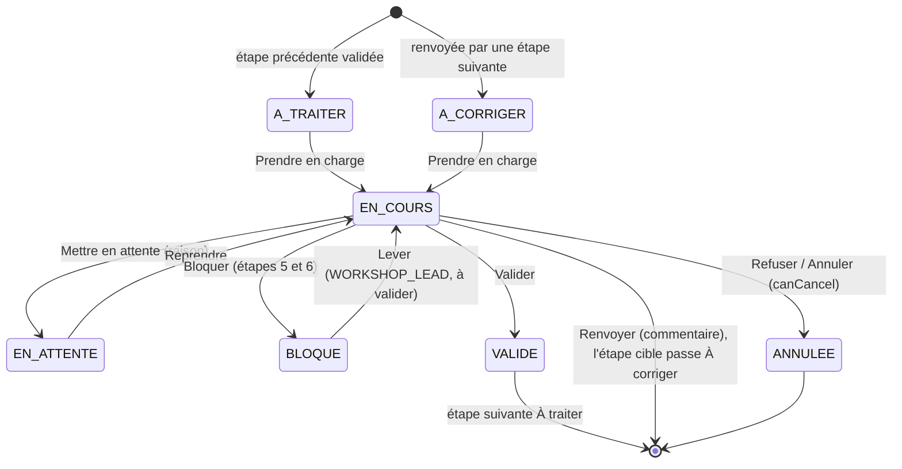

# Workshop maintenance: plan

A second kind of maintenance next to the field loop: the pump is brought to the workshop and goes through the 8 stages of `GreenSense_4_0_Actions_Plateforme_Maintenance.pdf`, with a different role acting at each step, and ends with the "Rapport d'expertise complet". Plan agreed on 4 November 2026.

## Progress

**Slice 1, Sales (4 November 2026): done and tested.** The manager's "Envoyer en atelier" route was tested in the browser up to step 3.

- Backend: `Intervention`, `InterventionEvent`, the enums (`WorkshopStep` with the 20 steps, `StepStatus`, `InterventionStatus`, `InterventionOrigin`, `InterventionAction`), `InterventionService`, `InterventionController` (`/api/v1/interventions`). Generic Prendre en charge / Valider / Annuler on any non-technician step.
- All the workshop roles and all 20 steps are declared now, even the ones no page uses yet, so the check constraint below is dropped only once.
- `register_manager` takes an optional `role`: `MANAGER` (default) or one of the workshop roles (`UserService.STAFF_ROLES`). Test accounts: `<role>@phova.com` (e.g. `business_ops@phova.com`).
- Frontend: the request form (`/atelier/nouvelle`, Sales or a manager from an alert), the intervention page (`/atelier/:id`), and "Envoyer en atelier" on the alert page.

**Slice 2, every workshop role (4 November 2026): done and tested through the API.**

- Every workshop role opens on the "Atelier" tab (`/atelier`, its queue), and validates its steps on the intervention page. The "Hello {role}" page (`RoleHome.jsx`, `/accueil`) is no longer used by any role.
- A test intervention was walked through steps 1–20 with each role's account: each step showed up in its role's queue, and was taken and validated; step 20 closed it as `TERMINÉE`.
- To test steps 9–20 the test intervention was moved past the technician's steps in the database.

**Slice 3, the Workshop Lead assigns the technician (5 November 2026): done and tested through the API.**

- Step 7 (Affecter équipe) and 15 (Autoriser montage) have no "Valider": once the Workshop Lead took the step, "Affecter un technicien" opens the manager's task order (`/atelier/:id/affecter`, `WorkshopAssign.jsx`, reusing `AssignTask.jsx`'s pickers). Step 7 pre-selects "Rapport d'expertise (démontage)" (step 15: "Rapport d'expertise (montage)", Informations générales + sections 20–23, `rapport_montage.json`): the full report's sections 1–19 (Informations générales → Pièces, items 1–92), same labels and layout (`usesCompleteLayout`), seeded from `rapport_demontage.json`. Its PDF is the standard one for now, not the PHOVA layout.
- `POST /api/v1/interventions/{id}/assign` (`InterventionAssignDto`) creates the `TaskModel` through `TaskService.createNewTask` (the Workshop Lead is its `managerEmail`, the pump is the intervention's), validates step 7 / 15 and moves the intervention to step 8 / 16 with `stepAssignee` = the technician and `Intervention.taskId`, in one transaction. The technician finds it in his Tâches like any order.
- The intervention page shows the task and its `TaskStatus` on step 8 / 16.
- **Not done yet:** step 8 / 16 moving on when the task is done (open question below), and a declined task going back to the Workshop Lead.

**Slice 4, the report's review (6 November 2026): done; tested through the API and in the browser up to the review page.**

- Sending the report (`SUBMITTED`) ends step 8 / 16: `TaskService.submitTask` publishes `TaskSubmittedEvent`, `InterventionService.onTaskSubmitted` moves the intervention to step 9 / 17 (À traiter, Workshop Lead's queue) with a "Rapport envoyé" event by the technician. A manager's task has no intervention: nothing happens.
- Step 9 / 17 (`reviewsTask`: `refuseTo` is a technician's step) offers `VALIDATE` and `RETURN`. "Examiner le rapport" opens `/atelier/:id/rapport` (`WorkshopReport.jsx`, the report view of `ReviewReport.jsx`). Valider approves the task (`APPROVED`) and passes on to step 10 / 18; Renvoyer (comment required) sets the task `RETURNED` and the intervention back to step 8 / 16, À corriger, with the technician. He resumes it ("Reprendre", task page) and sends a new report, which comes back to step 9 / 17.
- `POST /api/v1/task/{id}/approve` and `/return` (`TaskReturnDto`) now exist for the manager's Revue; they refuse a workshop task (409), which is reviewed from its intervention.
- The technician's task page (`TaskScreen.jsx`): Détails · Ask · Rapport, with Reprendre for a blocked or returned task.
- **Not done yet:** the Chef de projet can't open the report at step 10 (only its author and the task's sender can); a declined task going back to the Workshop Lead; the corrected report starts from an empty form.

**Before running it, once:** Hibernate put a check constraint on `users.role` listing the roles of the day the table was created, and `ddl-auto=update` never changes it. Saving a `SALES` user fails until it's dropped:

```sql
ALTER TABLE users DROP CONSTRAINT IF EXISTS users_role_check;
```

**Not done yet in slice 1:** the bon de commande attachment (typed attachments, "Later" below); cancellation by the launching manager.

## Decisions

1. **Each person has one role.** `User.role` stays a single `UserRole`; the new roles are added to the enum.
2. **The Pumps Maintenance Lead is not the field `MANAGER`.** He gets his own role, `WORKSHOP_LEAD`.
3. **The client never logs in.** Sales records the client's decisions (quote accepted or refused).
4. **Two ways in, both through Sales.** A client asks Sales to repair a pump (by phone or e-mail; Sales creates the request), or a manager opens an alert and chooses "Envoyer en atelier". Both land at step 1 with Sales, then follow the same loop. Every step that isn't the technician's is a simple decision; validating it moves the intervention to the next step and role.
5. **The commercial check (stage 01) comes before réception.** Each workshop repair needs the client's order or a contract before the pump is taken apart: démontage and expertise are charged even if the repair is cancelled, which only holds if an order existed before.
6. **Not decided yet** (section 4 of the PDF): who lifts a quarantine, who can cancel or close an intervention. Defaults below, marked "à valider" in the code.

## Flow

From the alert to the invoice. Solid arrows: "Valider". Dashed arrows: "Renvoyer" to a step other than the previous one, and "Refuser / Annuler". Every other step's "Renvoyer" goes back to the step just before it (see the steps table). Double-bordered boxes are the technician's tasks.

```mermaid
flowchart TB
    CLIENT(["Client<br/>téléphone, e-mail"]) -->|Sales crée la demande| S1
    ALERT(["Alerte"]) --> LAUNCH["Manager<br/>Envoyer en atelier"]
    LAUNCH --> S1

    subgraph E01["01 · Traitement de la demande"]
        S1["1 · SALES<br/>Compléter la demande"] --> S2["2 · BUSINESS_OPS<br/>Accepter la demande"]
        S2 --> S3["3 · CONTRACT_ADMIN<br/>Confirmer contrat / commande"]
    end

    subgraph E02["02 · Réception, décontamination et sécurité"]
        S4["4 · PROJECT_LEAD<br/>Enregistrer réception"] --> S5["5 · WORKSHOP_LEAD<br/>Réception conforme"]
        S5 --> S6["6 · HSE<br/>Analyse des risques"]
    end

    subgraph E03["03 · Démontage et expertise"]
        S7["7 · WORKSHOP_LEAD<br/>Affecter équipe"] --> S8[["8 · Technicien<br/>Démontage + rapport d'expertise"]]
    end

    subgraph E04["04 · Besoins PDR et chiffrage"]
        S9["9 · WORKSHOP_LEAD<br/>Valider rapport"] --> S10["10 · PROJECT_LEAD<br/>Valider besoins + envoyer devis"]
    end

    subgraph E05["05 · Disponibilité et préparation des PDR"]
        S11["11 · SALES<br/>Accord client sur devis"] --> S12["12 · PROJECT_LEAD<br/>Disponibilité PDR"]
        S12 --> S13["13 · STOREKEEPER<br/>Sortie des pièces"]
        S13 --> S14["14 · QUALITY<br/>Contrôle qualité PDR"]
    end

    subgraph E06["06 · Montage et essais"]
        S15["15 · WORKSHOP_LEAD<br/>Autoriser montage + affecter"] --> S16[["16 · Technicien<br/>Montage + essais"]]
    end

    subgraph E07["07 · Contrôle final et validation"]
        S17["17 · WORKSHOP_LEAD<br/>Contrôle final"] --> S18["18 · BUSINESS_OPS<br/>Valider attachement"]
    end

    subgraph E08["08 · Dossier final, livraison et clôture"]
        S19["19 · PROJECT_LEAD<br/>Dossier final + livraison"] --> S20["20 · BILLING<br/>Facturation"]
    end

    S3 --> S4
    S6 --> S7
    S8 --> S9
    S10 --> S11
    S14 --> S15
    S16 --> S17
    S18 --> S19
    S20 --> DONE(["TERMINÉE"])

    S3 -.->|Commande manquante| S1
    S6 -.->|Renvoyer| S4
    S17 -.->|Retour montage| S16
    S9 -.->|Renvoyer correction| S8

    S1 -.->|Non recevable| CANCEL(["ANNULÉE"])
    S2 -.->|Refuser| CANCEL
    S5 -.->|Retour client| CANCEL
    S11 -.->|Devis refusé| CANCEL
```



The life of one step (any step that isn't the technician's):



The diagrams are Mermaid: GitHub shows them as drawings; in VS Code the Markdown preview needs the "Markdown Preview Mermaid Support" extension.

## New roles

| PDF role | `UserRole` |
|---|---|
| Repair Technician | `USER` (existing) |
| Pumps Maintenance Lead | `WORKSHOP_LEAD` |
| Chef de projet / Préparateur | `PROJECT_LEAD` |
| HSE | `HSE` |
| Client / Sales | `SALES` |
| Business Operations Manager | `BUSINESS_OPS` |
| Contract Admin | `CONTRACT_ADMIN` |
| Magasinier | `STOREKEEPER` |
| Quality & Reliability Team | `QUALITY` |
| Responsable facturation | `BILLING` |

Each role works from a **shared queue**: everyone with the role sees the interventions waiting at its step. In `roleTabs.js` each new role gets one page, "Atelier".

## Entities

The steps are fixed, so they live in code, not in a table. Only one step is open at a time, so the intervention only stores which one.

```
Intervention       id, number (N° d'opération), equipmentId, origin (CLIENT / ALERT),
                   alertNumber (ALERT only), launchedBy (Sales' or the manager's email),
                   fault, urgent, client, customerOrderNumber (N° de commande client),
                   currentStep, stepStatus, stepAssignee, status (EN_COURS / TERMINÉE / ANNULÉE),
                   statusReason, statusComment, taskId (the technician's current task), timestamps
InterventionEvent  append-only, like TaskEvent: interventionId, step, actorEmail,
                   fromStatus, toStatus, reason, comment, occurredAt
WorkshopStep       enum: role, label, refuseTo (step sent back to), canBlock, canCancel
StepStatus         enum: A_TRAITER, EN_COURS, EN_ATTENTE, BLOQUE, A_CORRIGER, VALIDE
```

Past steps are implicitly `VALIDE`; who validated them and when is in `InterventionEvent`.

## Steps (first version)

| # | Stage | Step | Role | Renvoyer goes back to | Flags |
|---|---|---|---|---|---|
| 1 | 01 | Compléter la demande (panne, urgence, bon de commande) | `SALES` | — | `canCancel` (non recevable) |
| 2 | 01 | Accepter la demande | `BUSINESS_OPS` | 1 ("Demander complément") | `canCancel` ("Refuser") |
| 3 | 01 | Confirmer contrat / commande | `CONTRACT_ADMIN` | 1 ("Signaler commande manquante") | |
| 4 | 02 | Enregistrer réception | `PROJECT_LEAD` | 3 | |
| 5 | 02 | Réception conforme | `WORKSHOP_LEAD` | 4 | `canBlock`, `canCancel` (retour client) |
| 6 | 02 | Analyse des risques | `HSE` | 4 | `canBlock` |
| 7 | 03 | Affecter équipe (chooses the technician) | `WORKSHOP_LEAD` | 6 | |
| 8 | 03 | Démontage + rapport d'expertise | `USER` (task) | the task's `RETURNED` | |
| 9 | 04 | Valider rapport | `WORKSHOP_LEAD` | 8 | |
| 10 | 04 | Valider besoins + envoyer devis | `PROJECT_LEAD` | 9 | |
| 11 | 05 | Accord client sur devis (entered by Sales) | `SALES` | 10 | `canCancel` (devis refusé) |
| 12 | 05 | Disponibilité PDR | `PROJECT_LEAD` | 11 | |
| 13 | 05 | Sortie des pièces | `STOREKEEPER` | 12 | |
| 14 | 05 | Contrôle qualité PDR | `QUALITY` | 13 | |
| 15 | 06 | Autoriser montage + affecter | `WORKSHOP_LEAD` | 14 | |
| 16 | 06 | Montage + essais | `USER` (task) | the task's `RETURNED` | |
| 17 | 07 | Contrôle final | `WORKSHOP_LEAD` | 16 | |
| 18 | 07 | Valider attachement | `BUSINESS_OPS` | 17 | |
| 19 | 08 | Dossier final + livraison | `PROJECT_LEAD` | 18 | |
| 20 | 08 | Facturation | `BILLING` | 19, then the intervention is closed | |

The PDF runs some of these at the same time (PML and HSE at reception; Magasinier and Quality in stage 05). The first version puts them one after the other.

**The two ways into stage 01.**

| | Client asks | Manager asks (alert) |
|---|---|---|
| Who creates the intervention | Sales, from the client's call or e-mail | The manager, "Envoyer en atelier" |
| Pre-filled | nothing | equipment, fault, urgency |
| Step 1 starts | `EN_COURS`, assigned to the Sales person who created it | `A_TRAITER`, in the Sales queue |

From step 2 the two are the same. If Sales cancels an alert's request at step 1, the comment tells the manager why.

**From an alert,** "Envoyer en atelier" pre-fills the request from the alert: the equipment, the fault (the alert's message) and the urgency (`urgent` when the alert's priority is `HIGH` or `URGENT`). Sales completes it with the client, the N° de commande client and the bon de commande. These fields then fill the report's "Informations générales".

**Urgency.** The PDF asks to keep the difference between an urgent request and one with an order or contract in place: an urgent repair may need to start before the order is confirmed. In the first version step 3 is always required; an urgent request can wait at step 3 in `EN_ATTENTE` (`DOCUMENT_MANQUANT`). Letting it skip ahead is an open question.

## Step statuses

The PDF's status table is used for every step that isn't the technician's.

| PDF status | `StepStatus` | Technician's `TaskStatus` |
|---|---|---|
| À traiter | `A_TRAITER` | `ASSIGNED` |
| En cours | `EN_COURS` | `STARTED` |
| En attente | `EN_ATTENTE` | `BLOCKED` |
| Bloqué / Quarantaine | `BLOQUE` | `BLOCKED` (`SAFETY_ISSUE`) |
| À corriger | `A_CORRIGER` | `RETURNED` |
| Validé / Terminé | `VALIDE` | `APPROVED` |

The technician keeps `TaskStatus`; the intervention's timeline shows his task with the PDF's labels.

1. **"En cours" means someone took the step.** The queue is shared, so "Prendre en charge" records `stepAssignee` and takes the intervention out of the others' queue. Two HSE people can't work on the same file.
2. **"En attente" and "Bloqué" are different.** En attente is a normal wait (reason `DOCUMENT_MANQUANT`, `APPROBATION`, `PIECE`, `DECISION`) and the same person resumes it. Bloqué is for safety or compliance, only on the steps with `canBlock` (5 and 6), and is lifted by `WORKSHOP_LEAD` (à valider).
3. **"Refuser" has two meanings, so there are two buttons.**
   - **Renvoyer**: a correction. The `refuseTo` step becomes `A_CORRIGER`, a comment is required, the loop goes on.
   - **Refuser / Annuler**: a final no (request refused, quote refused by the client, pump not decontaminated → back to the client). The intervention becomes `ANNULÉE` with its reason and comment. Only on the steps with `canCancel`.
4. **Time per step comes free.** The events give how long a step waited in À traiter and in En attente, as `workedSeconds` does for tasks.

## Allowed transitions (one step)

| From | To | Who | Comment / reason required |
|---|---|---|---|
| — | `A_TRAITER` | Previous step validated, or manager launching the intervention | No |
| `A_TRAITER` | `EN_COURS` | Step's role ("Prendre en charge") | No |
| `EN_COURS` | `VALIDE` → next step `A_TRAITER` | Step's assignee | No |
| `EN_COURS` | `EN_ATTENTE` | Step's assignee | Yes (reason) |
| `EN_ATTENTE` | `EN_COURS` | Step's assignee | No |
| `EN_COURS` | `BLOQUE` | Step's assignee, `canBlock` steps only | Yes |
| `BLOQUE` | `EN_COURS` | `WORKSHOP_LEAD` (à valider) | Yes |
| `EN_COURS` | `refuseTo` step `A_CORRIGER` | Step's assignee ("Renvoyer") | Yes |
| `A_CORRIGER` | `EN_COURS` | Target step's role | No |
| `EN_COURS` | intervention `ANNULÉE` | Step's assignee, `canCancel` steps only | Yes |
| any | intervention `ANNULÉE` | Launching manager (à valider) | Yes |
| step 20 `VALIDE` | intervention `TERMINÉE` | — | No |

Steps 8 and 16 follow the task's own transitions (`maintenace_loop_servicetohandle.md`). Step 7 / 15 creates a `TaskModel` with the "Rapport d'expertise complet" template and `interventionId`; the task reaching `APPROVED` validates the step.

## Backend

1. **One method changes the state**, like `TaskService`: `perform(interventionId, action, reason, comment)` checks the role, the assignee, the step status and the step's flags, updates the intervention and writes the `InterventionEvent` in the same transaction.
2. **Endpoints**
   - `POST /interventions`: by a manager from an alert (`origin = ALERT`, step 1 `A_TRAITER`, equipment, fault and urgency from the alert), or by Sales for a client (`origin = CLIENT`, step 1 `EN_COURS`, assigned to the caller).
   - `GET /interventions/queue`: the interventions waiting at a step of the caller's role.
   - `GET /interventions/{id}`: the intervention, its events, and `availableActions` for the caller, so the page only shows the buttons he may press.
   - `POST /interventions/{id}/actions` `{ action, reason, comment }`.
3. **Technician steps** reuse the existing task loop. The montage task gets a `FormDraft` pre-filled from the validated expertise submission, so the final PDF holds both halves of the report.
4. **"Informations générales" of the report** (client, N° d'opération, date de réception, raison) are filled from the intervention, not typed again by the technician.

## Frontend

1. **Alert page** ([AlertDetail.jsx](my-react-app/src/AlertDetail.jsx)): an "Envoyer en atelier" button next to "Créer un ordre". The alert case stores the intervention's id, like `orders[]` stores task ids (the cases still live in localStorage, `alertStore.js`).
2. **"Nouvelle demande" form** for Sales: the client's request (equipment, fault, urgency, client, N° de commande client, bon de commande).
3. **"Atelier" page** for the new roles: their queue, then the intervention's file (steps, timeline, comments) with the buttons from `availableActions`.
4. **`roleTabs.js`**: add the new roles to `ROLE_TABS`.

## Later

1. Steps that run at the same time (PML + HSE, Magasinier + Quality): a step table and "stage done when all its steps are validated".
2. Structured parts (`PartRequest`: code, quantity, source client / PHOVA / achat, sortie, QC), replacing the free-text "Pièces : Liste des pièces".
3. Typed attachments (FDS, fiche de décontamination, devis, BL) and steps that can't be validated without them.
4. Notifications to the next role.
5. Warranty returns (stage 03 condition).

## Open questions

- ~~**When does step 8 / 16 end?**~~ Decided 6 November 2026: the report being sent moves the intervention to step 9 / 17, where "Valider" approves the task (slice 4).

1. May an urgent request go on to réception before the Contract Admin confirms the order (step 3)?
2. Who lifts a quarantine?
3. Who can cancel or close an intervention?
4. Electronic signatures; who validates the logistics steps; expected notifications and delays (section 4 of the PDF).
